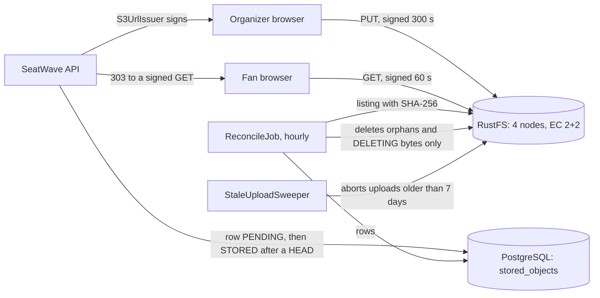

# Architecture

`seatwave-files` keeps SeatWave's tickets and posters in an S3-compatible object store. The teaching
models need only the JDK; the adapters that talk to a real store (RustFS 1.0.5 in the lab, S3 in
production) and to PostgreSQL 18.6 are a source set of their own.

## Packages

One package, `io.plainround.seatwave.files`, in two source sets:

- `src/main` (JDK only): `UrlGrant` and `UrlVerdict` (what a pre-signed URL allows, and the store's
  answer), `PresignedUrlSigner` (a teaching model of a signed URL, HMAC-SHA-256), `MultipartUpload`
  (the store's side of one multipart upload), `ContentAddress` (SHA-256 keys, Module 17's CDN names),
  `ObjectReconciler` (database rows against a bucket listing), and four programs:
  `PresignedUrlDemoCli`, `MultipartDemoCli`, `IntegrityDemoCli`, `StorageCostCli`.
- `src/sdk` (AWS SDK for Java 2.58.0, PostgreSQL JDBC 42.7.14, result4j 1.2.0): `StoreSettings`
  (`config/store.properties` and the credentials in `.secrets/`), `ObjectStore` (the four buckets,
  lifecycle rules, checksummed uploads, a listing with checksums, incomplete uploads), `S3UrlIssuer`
  (real Signature Version 4 URLs), `StoreHttp` (plain HTTP, as a browser or an anonymous visitor),
  `StoredObjectsTable` (JDBC over `stored_objects`), `ReconcileJob` (the reconciler wired to both),
  `StaleUploadSweeper` (aborts multipart uploads older than 7 days), and four programs:
  `SetupBucketsCli`, `TicketLinksCli`, `MultipartLostPartCli`, `ReconcileCli`.

## The dependency rule

`src/main` depends on nothing but the JDK. `src/sdk` depends on `src/main` and on the libraries
above; nothing in `src/main` knows the SDK exists. Programs (`*Cli`) are the only code that prints or
exits; `LabSettings` is the one place a settings problem becomes an exit status.

## Data flow

## Walk-throughs

- A ticket download: the API finds the booking's row, checks it is `STORED`, and answers with a
  redirect to a URL `S3UrlIssuer.downloadUrl` signed for 60 seconds. The store checks the signature
  and the expiry; an anonymous request for the same key gets 403.
- A poster upload: the API inserts a `PENDING` row and returns `S3UrlIssuer.signedUpload`'s URL and
  headers; the signature covers the content type, the length and `If-None-Match: *`, so the store
  refuses another type (403) and a second upload to the key (412). The confirmation step reads the
  object's checksum and moves the row to `STORED`.
- The hourly job: `ReconcileJob.apply` reads the rows and the listing, and `ObjectReconciler` sorts
  every difference. The job deletes only bytes that no row names (after checking again, just before
  the delete) and bytes whose row says `DELETING`; it drops `PENDING` rows older than the grace
  period; a `STORED` row whose bytes are missing or different is reported, never changed.

## Decisions and trade-offs

- The lab's store is RustFS 1.0.5; `docs/store-choice.md` has the comparison of 12 November 2026
  and why MinIO, which the module first planned, was replaced.
- Four nodes with one volume each, not one node with four volumes: RustFS refuses an erasure set
  built from folders on one physical device, and the bypass is for testing only. The volumes still
  share the virtual machine's disk, so the drill proves the mechanism, not failure independence.
- The SDK client sends plain request bodies (`chunkedEncodingEnabled(false)`) with the SHA-256 in a
  header: RustFS 1.0.5 answered the SDK's `aws-chunked` bodies with 400 BadDigest.
- The lifecycle transition of `lifecycle/seatwave-media.json` (posters to `STANDARD_IA`) is not
  applied to the lab's store, which has no storage classes; the file keeps it for S3.
- The 7-day rules cannot be watched acting in a lab, so `StaleUploadSweeper` makes the abort
  decision on demand, with the same 7 days, and the tests move the clock instead of waiting.
- Each `StoredObjectsTable` call opens its own connection: the job runs hourly, and a pool would be
  code with nothing to measure.

## Invariants and where they are enforced

| Invariant | Enforced by | Pinned by |
|---|---|---|
| No object is readable without a signed URL | the store: buckets created private, no policy | `StoreAccessStackTest` (anonymous GET and LIST answer 403) |
| A signed URL allows only what was signed, until its expiry | the store's Signature Version 4 check | `StoreAccessStackTest`; `PresignedUrlSignerTest` for the model |
| An upload never replaces an object | `If-None-Match: *` in the signature | `refusesASecondSignedUploadToAKeyThatExists` |
| A `STORED` row's object is never deleted | `ObjectReconciler` (no orphan has a row) and `ReconcileJob` (row checked again) | `neverCountsTheObjectOfAStoredRowAsAnOrphan`, `neverDeletesTheObjectOfAStoredRow` |
| A `STORED` row without its bytes is reported, not changed | `ReconcileJob` acts on no `missing` key | `reportsAStoredRowWhoseBytesAreMissingAndKeepsTheRow` |
| A part is stored only with the bytes its sender hashed | the store's checksum check; `MultipartUpload` in the model | `MultipartUploadTest`, `MultipartLostPartCli` |
| An upload is aborted only after 7 days | `StaleUploadSweeper.stale` | `StaleUploadSweeperTest`, `StaleUploadStackTest` |
| One row per key, a ticket names its booking, a `PENDING` row has no stored time | the constraints of `db/V1__stored_objects.sql` | PostgreSQL itself |
| Settings problems are reported together and no credential is printed | `StoreSettings.load` and `toString` | `StoreSettingsTest` |
